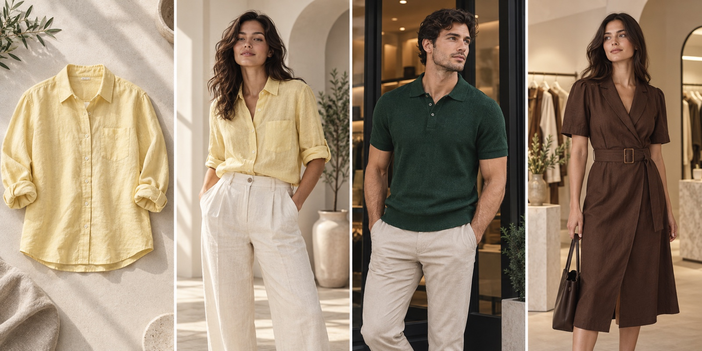

<h1 align="center">ModelSnap</h1>

  AI fashion model photography for independent clothing brands, online boutiques, and marketplace sellers.

  <a href="https://modelsnap.app/"><strong>Visit Website</strong></a> ·
  <a href="https://modelsnap.app/app"><strong>Create a Product Image</strong></a> ·
  <a href="https://modelsnap.app/#examples"><strong>View Examples</strong></a> ·
  <a href="https://modelsnap.app/pricing"><strong>Pricing</strong></a>

  

## What is ModelSnap?

[ModelSnap](https://modelsnap.app/) is a practical AI photo studio for clothing sellers. Upload a flat lay, ghost-mannequin image, hanging garment, or clean product photo; choose an adult AI fashion model and scene; then create store-ready on-model photography without organizing a traditional photoshoot.

The product is designed for real listing work: compare each result with the source garment, refine the selected image, and download the original file for your storefront or marketplace.

## What you can create

- **On-model product photos** from flat lays, mannequin images, and clean clothing shots
- **Consistent catalog imagery** using a reusable model and scene setup
- **Marketplace-ready formats** for product pages, collection grids, and storefront banners
- **Model swaps** for existing clothing product photography
- **Bulk product images** for larger collections and catalog refreshes
- **Custom AI model looks** that better match a brand's creative direction

## Use cases

### Independent clothing brands

Build a recognizable visual direction without scheduling a new studio shoot for every drop. Reuse a preferred model, scene, and photo setup across new arrivals.

### Online boutiques

Turn supplier flat lays and mannequin shots into a more cohesive product catalog with clear on-model context for fit, silhouette, and garment length.

### Etsy, Shopify, and marketplace listings

Create portrait product photos, square collection images, and landscape storefront visuals while keeping the source garment as the reference.

### Catalog refreshes and testing

Update mixed legacy photography or quickly test a new on-model presentation before investing in a larger campaign.

## How it works

1. Upload one clear clothing product photo.
2. Choose an AI fashion model, scene, and output settings.
3. Generate the on-model product image.
4. Compare color, print, texture, seams, fasteners, length, and proportions with the source garment.
5. Refine and download the approved result.

## Explore ModelSnap

| Workflow | Link |
| --- | --- |
| Create Product Image | [Open the AI fashion studio](https://modelsnap.app/app) |
| Flat Lay to Model | [Turn flat lays into model images](https://modelsnap.app/flat-lay-to-model) |
| Ghost Mannequin to Model | [Create on-model photos from mannequin shots](https://modelsnap.app/ghost-mannequin-to-model) |
| AI Model Photoshoot | [Build a virtual clothing photoshoot](https://modelsnap.app/ai-model-photoshoot) |
| Model Swap | [Replace the model in a product photo](https://modelsnap.app/model-swap) |
| Free Generator Guide | [Explore the free AI fashion model workflow](https://modelsnap.app/ai-fashion-model-generator-free) |
| Clothing Photography Guide | [Plan better ecommerce clothing photos](https://modelsnap.app/clothing-photography) |

## Output options

- Portrait images for product pages
- Square images for collection grids
- Landscape images for storefront banners
- JPG and PNG downloads
- 1K and 2K output options

## Review before publishing

AI-generated results can vary. Always compare the finished image with the real garment before publishing, especially color, print, logos, fabric texture, neckline, sleeves, seams, fasteners, fit, length, and proportions.

## About this repository

This is the public product overview repository for ModelSnap. The application source code is proprietary and maintained in a private repository.

For product access, examples, pricing, and support, visit **[modelsnap.app](https://modelsnap.app/)**.
